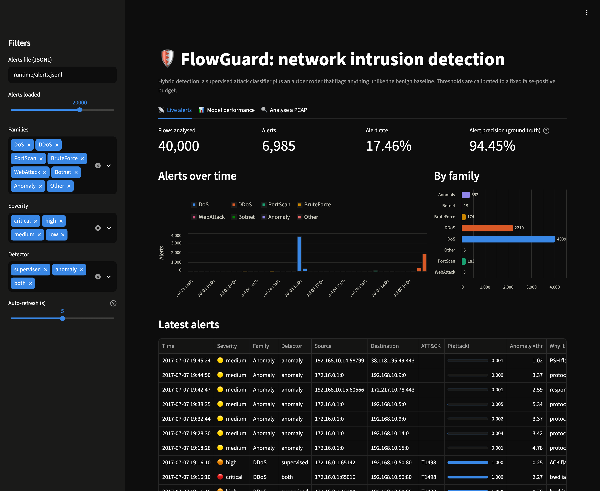
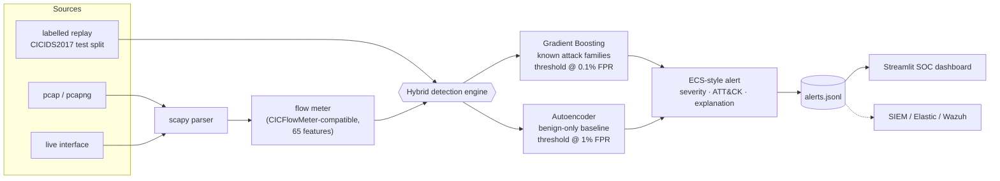

# FlowGuard: hybrid ML network intrusion detection

[](https://github.com/hugo-kte/flowguard-nids/actions/workflows/ci.yml)


FlowGuard detects network attacks from flow statistics. A **supervised classifier** recognises
known attack families with a 0.1% false-positive budget, and an **autoencoder trained only on
benign traffic** raises leads on flows that look like nothing normal. It reads pcaps, sniffs live
interfaces or replays labelled traffic, and emits ECS-style JSON alerts mapped to
**MITRE ATT&CK**, with an explanation of *why* each flow is unusual.

The project is built around one question that most ML-IDS write-ups skip: **how good is the
detector when it has to work in practice**? That means at a fixed alert budget, on deduplicated
and correctly labelled data, on live packets rather than a CSV, and against attacks it has
never seen.

<p align="center">
  
</p>

## Results at a glance

Test split of the improved CICIDS2017: **342,536 flows, 56,378 of them attacks**, never used
for training or threshold calibration. Every number below is regenerated by
`flowguard evaluate` (full tables in [`reports/REPORT.md`](reports/REPORT.md)).

| Detector | Alert budget | Detection rate | False-positive rate | Precision |
|---|---:|---:|---:|---:|
| Gradient Boosting (supervised) | 0.1% | **99.998%** | 0.096% | 99.5% |
| Autoencoder (benign traffic only) | 1% | 10.8% | 1.04% | 67.3% |
| **Hybrid** (GB *or* autoencoder) | | **99.998%** | 1.11% | 94.7% |

**Key findings**

1. **Known attacks are easy on this dataset.** The supervised model detects 99.998% of attack
   flows at a 0.1% false-positive rate. Most ML-IDS write-ups stop here.
2. **Unseen attacks are not.** Retrained without one attack family, the same model detects on
   average only **23%** of it (port scans 2.5%, brute force 4.8%, botnet 0%). The benign-only
   autoencoder raises the average to **37%**, and port scans to 80%.
3. **The classifier learns a tool's fingerprint, not the attack.** A Hulk-style HTTP flood
   rebuilt from packets is detected 100% of the time. Implemented with an orderly connection
   close and MSS-sized segments (what a network tap sees), the *same* flood is detected
   **0%** of the time by both detectors: one flow at a time, a flood looks like ordinary web
   traffic.
4. **Data quality decides the result before the model does.** 18% of the rows are exact
   duplicates (97% of port-scan flows), header-length counters wrap around at 16 bits, and the
   "initial window" column actually holds the *last* packet's window. Left unhandled, each of
   these inflates scores or silently breaks train/serve parity.

## What this project demonstrates

| | |
|---|---|
| **Train/serve parity** | A from-scratch Python port of the (fixed) CICFlowMeter, so a model trained on CSV features can score raw packets with *identical* feature semantics. Unit tests check it against hand-computed flows and a lossless pcap round trip. |
| **Honest evaluation** | Corrected CICIDS2017 release, "Attempted" flows relabelled, 18% duplicate rows removed, identifiers (IPs, ports, timestamps) excluded from features, thresholds calibrated on a separate validation split. |
| **Operational metrics** | Detection rate at a fixed false-positive budget (not accuracy), per-family breakdown, ROC on a log-FPR axis, inference throughput. |
| **Zero-day simulation** | Leave-one-family-out retraining measures what the supervised model misses when an attack is new, and how much the anomaly detector recovers. |
| **SOC-ready output** | Tiered alerts (high-fidelity vs. leads) with severity, ATT&CK technique and feature-level explanation, as JSONL for a SIEM, plus a Streamlit dashboard. |
| **Secure ML engineering** | SHA-256-verified model bundle (unpickling is code execution), non-root container, secret scanning in pre-commit, no payload inspection. |
| **Software engineering** | Typed config (pydantic), CLI (typer), 37 tests, CI on Python 3.11-3.13, Docker image, Makefile. |

## Architecture



Training follows the same path offline: `CICIDS2017 CSVs → cleaning → stratified split →
fit → threshold calibration on validation → SHA-256-stamped model bundle`.

## Quickstart

```bash
git clone https://github.com/hugo-kte/flowguard-nids.git && cd flowguard-nids
make install        # creates .venv, installs FlowGuard + dashboard + dev tools
```

**1-minute demo, no download.** Trains on generated traffic, writes a report, builds a pcap
containing a port scan, an HTTP flood, an SSH brute force and slowloris, then analyses it:

```bash
make quickstart
```

**Full pipeline on CICIDS2017** (328 MB download, about 10 minutes on a laptop):

```bash
make pipeline       # download + verify SHA-256, train 4 models, evaluate, write reports/
```

**SOC dashboard.** Replay the labelled test traffic as if it were live, then watch the alerts:

```bash
make replay         # terminal 1
make dashboard      # terminal 2 -> http://localhost:8501
```

## Usage

```text
flowguard prepare    Load, clean and cache the dataset; print the cleaning report
flowguard train      Split, fit every model, calibrate thresholds, save the bundle
flowguard evaluate   Test-set metrics, zero-day experiment, figures, reports/REPORT.md
flowguard detect     Analyse a pcap offline and print/write alerts
flowguard sniff      Live capture from an interface (root required)
flowguard replay     Stream the labelled test split through the engine
flowguard dashboard  Launch the Streamlit dashboard
flowguard demo-pcap  Generate a pcap with benign traffic and four attacks
flowguard info       Show what a model bundle contains (nothing is unpickled)
```

```bash
flowguard detect capture.pcap -o alerts.jsonl          # offline analysis
sudo flowguard sniff -i en0                            # live (Linux: -i eth0)
flowguard replay --day friday --rate 2000              # PortScan, DDoS and Botnet day
```

**Docker:**

```bash
docker compose up --build                              # replay + dashboard on :8501
docker run --rm -v "$PWD/artifacts:/app/artifacts:ro" -v "$PWD:/data" \
    flowguard:latest detect /data/capture.pcap
docker run --rm --net=host --cap-add=NET_RAW --user root \
    -v "$PWD/artifacts:/app/artifacts:ro" flowguard:latest sniff -i eth0
```

## How it works

### 1. Data: why the *improved* CICIDS2017

The original CICIDS2017 CSVs contain documented flaws: flows cut at the first FIN, mislabelled
attack traffic, artefacts of the feature extractor ([Engelen et al., 2021](https://intrusion-detection.distrinet-research.be/WTMC2021/)).
FlowGuard uses the improved release from the same research group
([Liu et al., 2022](https://intrusion-detection.distrinet-research.be/CNS2022/)) and applies
four traceable cleaning steps (counts are in [`reports/REPORT.md`](reports/REPORT.md)):

1. **"Attempted" flows are relabelled benign**, as the authors recommend: they belong to an
   attack run but carry no malicious behaviour (e.g. a handshake that never sent a payload);
2. non-IP artefacts (protocol 0) are dropped;
3. infinite rates of zero-duration flows are set to 0 (the value our flow meter emits);
4. **exact duplicates are removed**: 18% of all rows and 97% of port-scan flows (nmap probes
   produce identical feature vectors). Otherwise the same vector lands in both train and test
   and inflates every score.

Two quirks of the CSVs are *kept* and reproduced by the flow meter instead: header-length sums
are stored in a signed 16-bit field and wrap around on long flows, and the
`Bwd Init Win Bytes` column holds the window of the *last* backward packet, not the first
(98% of DoS flows report 235, a scaled window, although their SYN-ACK is in the flow).
"Fixing" either in the data would make live features disagree with what the models learned.

Attack labels are grouped into eight families (DoS, DDoS, PortScan, BruteForce, WebAttack,
Botnet, Infiltration, Heartbleed). The nmap sweep run from the compromised host
(`Infiltration - Portscan`) is behaviourally a port scan and joins *PortScan*.

### 2. Features and train/serve parity

[`features/flowmeter.py`](src/flowguard/features/flowmeter.py) rebuilds bidirectional flows
from packets with the same rules as the fixed CICFlowMeter used to produce the dataset:
120 s active timeout, a TCP flow closed by FIN+FIN+ACK or RST, leading SYN-ACK flips the
orientation, payload bytes exclude Ethernet padding, sample standard deviations, 5 s
activity timeout for active/idle periods. Quirks of the reference implementation are
reproduced on purpose and marked `# parity:` (e.g. the initial forward window is only set by
a forward *first* packet).

The 65 features cover packet counts and sizes per direction, inter-arrival times, TCP flags,
initial windows, header lengths, rates and active/idle periods. **Identifiers are
excluded** (IPs, ports, timestamps): they would let a model memorise the lab topology
("traffic from 205.174.165.73 is an attack") instead of learning behaviour.

### 3. Models and calibrated thresholds

| Model | Trained on | Score | Role |
|---|---|---|---|
| Histogram Gradient Boosting | all families (benign capped at 500k) | 1 - P(benign) | primary classifier |
| Random Forest | all families | 1 - P(benign) | comparison |
| MLP autoencoder (65-48-16-48-65) | benign only | standardised reconstruction error | anomaly leads + explanations |
| Isolation Forest | benign only | path-length anomaly score | comparison |

Accuracy is meaningless for an IDS: the cost is analyst time spent on false alarms. Each
threshold is therefore the quantile of the model's scores on **validation benign traffic**
that meets a false-positive budget: 0.1% for supervised alerts, 1% for anomaly leads.
The test set then shows whether that budget holds on unseen traffic.

The autoencoder scores **standardised residuals**: each feature's squared reconstruction
error is divided by its typical error on held-out benign traffic, so naturally noisy
features (jittery inter-arrival times) do not drown the signal. The largest residuals
become the alert explanation.

### 4. Alerts

```json
{
  "@timestamp": "2017-07-04T12:20:48.640685+00:00",
  "event": {
    "kind": "alert",
    "category": [
      "network",
      "intrusion_detection"
    ],
    "module": "flowguard",
    "severity": 73,
    "created": "2026-10-10T23:14:13.848+00:00"
  },
  "rule": {
    "name": "FlowGuard ML - BruteForce"
  },
  "source": {
    "ip": "172.16.0.1",
    "port": 52306
  },
  "destination": {
    "ip": "192.168.10.50",
    "port": 21
  },
  "network": {
    "transport": "tcp",
    "packets": 28,
    "bytes": 318,
    "duration_us": 7759896
  },
  "flowguard": {
    "family": "BruteForce",
    "detector": "supervised",
    "severity": "high",
    "attack_probability": 1.0,
    "anomaly_score": 5.6917,
    "anomaly_ratio": 0.51,
    "explanation": [
      "fwd pkt len max = 25",
      "RST flags = 2",
      "packet rate (pkt/s) = 3.61"
    ],
    "ground_truth": "FTP-Patator"
  },
  "threat": {
    "framework": "MITRE ATT&CK",
    "tactic": {
      "name": "Credential Access"
    },
    "technique": {
      "id": "T1110",
      "name": "Brute Force"
    }
  }
}
```

Severity comes from the family and is escalated when both detectors agree. Anomaly-only
alerts have no ATT&CK technique: they are leads for an analyst, not verdicts.

## Detailed results

### Detection vs. false-positive rate


Detection rate on the test set when each model's threshold is calibrated on validation for a
given budget:

| Model | 0.1% FPR budget | 1% FPR budget | 5% FPR budget |
|---|---:|---:|---:|
| Random Forest | 99.998% | 99.998% | 99.998% |
| Gradient Boosting | 99.998% | 99.998% | 99.998% |
| Isolation Forest | 0.06% | 2.8% | 8.3% |
| Autoencoder | 0.5% | 10.8% | 39.8% |

On known attacks the supervised models are not limited by the budget at all (the one missed
flow, a single port-scan probe, looks benign at every budget). The anomaly
detectors trade false alarms for coverage, which is why their alerts are a separate,
lower-severity tier.

### Per attack family


The autoencoder never sees an attack, yet it flags 79% of port scans, 71% of infiltration flows
and both Heartbleed flows: structurally unusual traffic. It misses brute force (0%) and most
DoS/DDoS flows (8-12%), because one at a time they look like normal logins and HTTP requests.
WebAttack (21 test flows), Infiltration (7) and Heartbleed (2) are too rare for stable
per-class precision: the operational multi-class macro-F1 is 0.80 (0.92 with plain argmax),
and these classes account for the gap ([confusion matrix](reports/figures/confusion_matrix.png)).

### Zero-day simulation


| Held-out family | Supervised, seen | Supervised, unseen | Autoencoder | Hybrid, unseen |
|---|---:|---:|---:|---:|
| DoS | 100% | 33.3% | 7.7% | 36.9% |
| DDoS | 100% | 100% | 11.7% | 100% |
| PortScan | 99.9% | 2.5% | 78.7% | 80.4% |
| BruteForce | 100% | 4.8% | 0% | 4.8% |
| Botnet | 100% | 0% | 2.0% | 2.0% |
| WebAttack | 100% | 0% | 0% | 0% |
| **Mean** | **100%** | **23.4%** | **16.7%** | **37.4%** |

DDoS is still detected without any DDoS in training because the DoS family already taught the
model what a flood connection looks like. Brute force, botnet C2 and web attacks look like
normal sessions to every per-flow model: catching them unseen needs payload or host-level
context.

### Robustness probe: one flood, seven implementations


The probe generates 300 Hulk-style connections as packets, meters them with the flow meter and
changes one implementation detail at a time. The victim's TCP window, page size and latency do
not matter; how connections are closed and how responses are segmented does. Change both and
the flood becomes invisible. This is the strongest argument for the first roadmap item:
host-level features over time windows.

### Real packets: the demo capture

`flowguard demo-pcap` writes a synthetic capture with benign web/DNS clients and four attacks
shaped after the CICIDS2017 flow profiles. Analysed with the CICIDS2017 models
(`flowguard detect demo/demo.pcap`):

| Scenario | Flows | Alerted | Classified as |
|---|---:|---:|---|
| Benign web + DNS clients | 360 | 1.7% (anomaly leads only) | - |
| Port scan (nmap -sS) | 100 | 95% | PortScan, T1046 |
| HTTP flood (Hulk-style) | 60 | 100% | DoS, T1499 |
| Slowloris | 6 | 100% | DoS, T1499 |
| SSH brute force (Patator-style) | 24 | 100% | BruteForce, T1110 |

The attacks are detected *because* they were shaped after the real tools' flows; the probe
above shows what happens when they are not.

### What the classifier relies on


Batch scoring runs at about 150,000 flows/s for Gradient Boosting and 200,000 flows/s for the
autoencoder on a laptop (Intel i9-9880H). In live mode the Python packet parsing is the
bottleneck, not the models.

## Project structure

```text
src/flowguard/
├── features/      flowmeter.py (CICFlowMeter port), pcap.py (scapy adapters), schema.py
├── data/          cicids2017.py (load + clean), labels.py, split.py, synthetic.py
├── models/        supervised.py, anomaly.py, preprocessing.py, registry.py (verified bundle)
├── evaluation/    evaluate.py, zeroday.py, probe.py (flood variants), metrics.py, plots.py, report.py
├── detection/     engine.py (hybrid engine, live monitor, replay), alerts.py (ECS + ATT&CK)
├── dashboard/     app.py (Streamlit)
├── training.py    split -> fit -> calibrate -> save
└── cli.py         typer CLI
configs/           cicids2017.yaml, synthetic.yaml
reports/           metrics.json, REPORT.md, figures/ (generated by `flowguard evaluate`)
tests/             37 tests: flow meter, cleaning, models, detection, CLI, dashboard
docs/MODEL_CARD.md
```

## Limitations

* **One lab network, 2017.** Benign profiles and attack tooling have changed (QUIC, TLS 1.3,
  cloud traffic). Thresholds must be re-calibrated, and ideally the models re-trained, on the
  network where FlowGuard runs.
* **In-distribution scores are optimistic.** Test attacks come from the same tool runs as
  training attacks. The zero-day experiment is the better guide to real-world behaviour.
* **Per-flow blind spots.** A single DoS or brute-force flow looks like a normal HTTP request
  or SSH login; what gives these attacks away is the *volume* across flows.
* **Single-packet flows are ignored** (the training data contains none), so a SYN scan
  against filtered ports produces no flow to score.
* **No adversarial robustness is claimed**: an attacker who knows the features can shape
  timing and packet sizes.
* **Python packet parsing** (scapy) handles a few thousand packets per second: enough for
  a lab or a pcap, not for a 10 Gbit/s link. The flow meter has no dependency, so a faster
  capture front-end (dpkt, PF_RING, a Zeek/CICFlowMeter export) can be plugged in.

## Roadmap

- [ ] **Host-level behavioural features**: per-source flow rate, distinct destination ports,
  failed-handshake ratio over sliding windows. This targets the per-flow blind spot above.
- [ ] Cross-dataset evaluation (train on CICIDS2017, test on CSE-CIC-IDS2018).
- [ ] SHAP explanations for supervised alerts.
- [ ] Adversarial evaluation: systematic feature-space evasion of the classifier, extending the
  flood probe to every family.
- [ ] Faster capture front-end and a Kafka/Elastic output.

## Responsible use

FlowGuard is a defensive research and teaching tool. Only capture traffic on networks you
own or are authorised to monitor; packet capture may be regulated (e.g. GDPR in the EU).
The demo pcap is synthetic and contains no real payload.

## References

* I. Sharafaldin, A. H. Lashkari, A. A. Ghorbani. *Toward Generating a New Intrusion Detection
  Dataset and Intrusion Traffic Characterization*. ICISSP 2018. (CICIDS2017)
* G. Engelen, V. Rimmer, W. Joosen. *Troubleshooting an Intrusion Detection Dataset: the
  CICIDS2017 Case Study*. IEEE S&P Workshops (WTMC) 2021.
* L. Liu, G. Engelen, T. Lynar, D. Essam, W. Joosen. *Error Prevalence in NIDS datasets: A Case
  Study on CIC-IDS-2017 and CSE-CIC-IDS-2018*. IEEE CNS 2022. (improved dataset used here)
* R. Sommer, V. Paxson. *Outside the Closed World: On Using Machine Learning for Network
  Intrusion Detection*. IEEE S&P 2010.
* D. Arp et al. *Dos and Don'ts of Machine Learning in Computer Security*. USENIX Security 2022.

## License

[MIT](LICENSE). The CICIDS2017 data is not redistributed here; see the dataset authors' terms.
