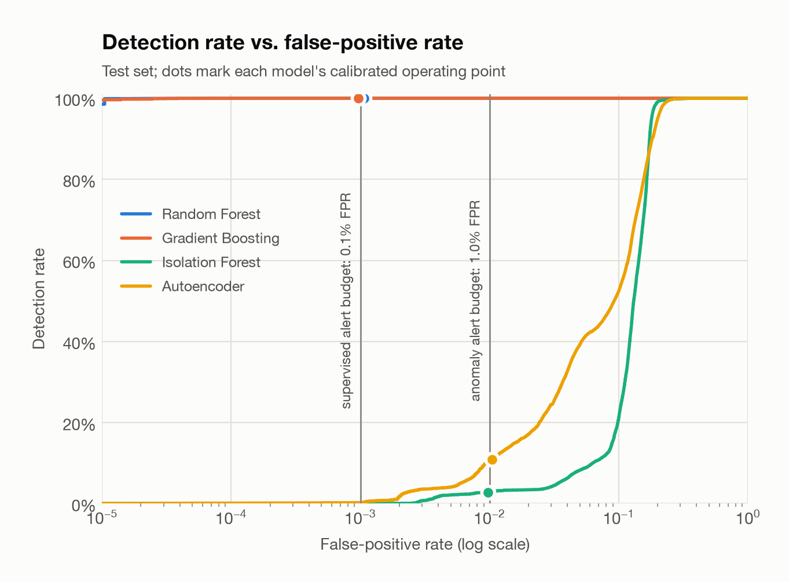
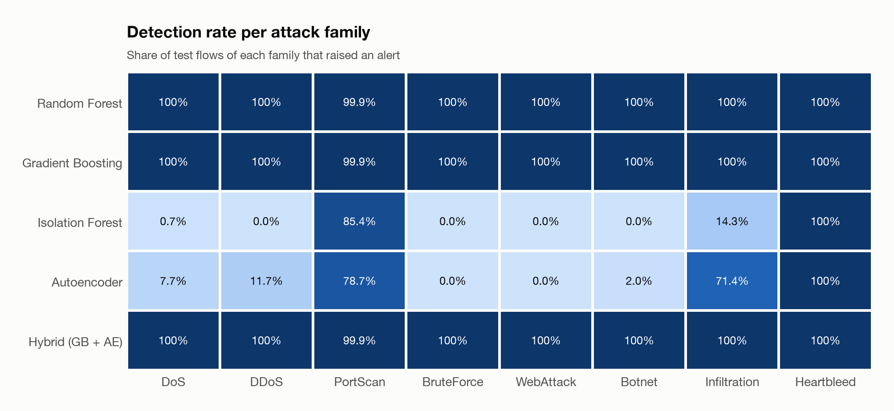
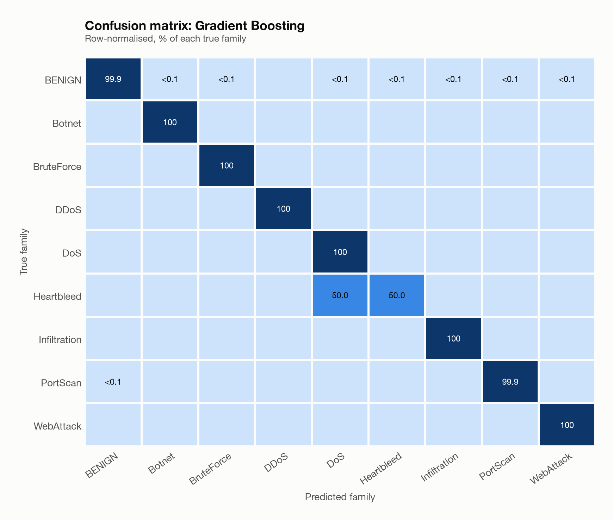
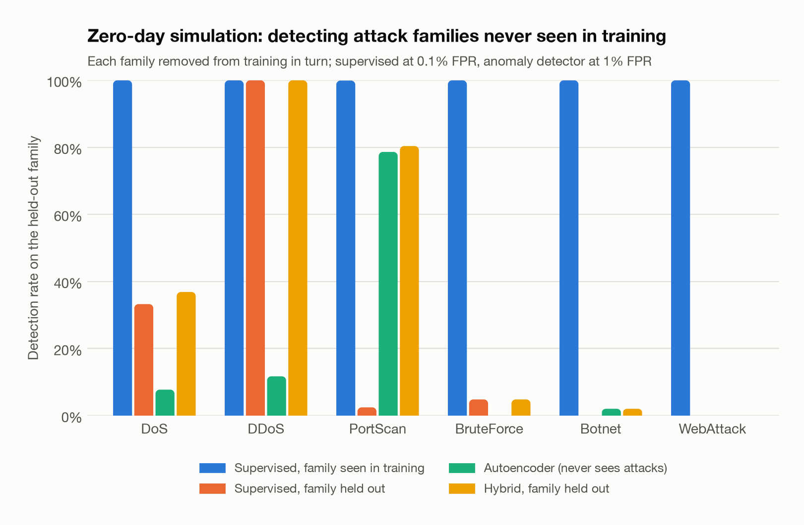
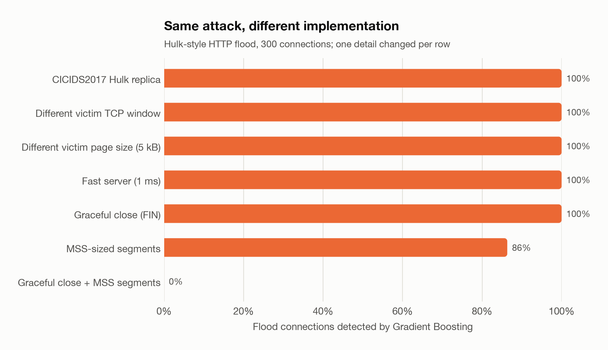
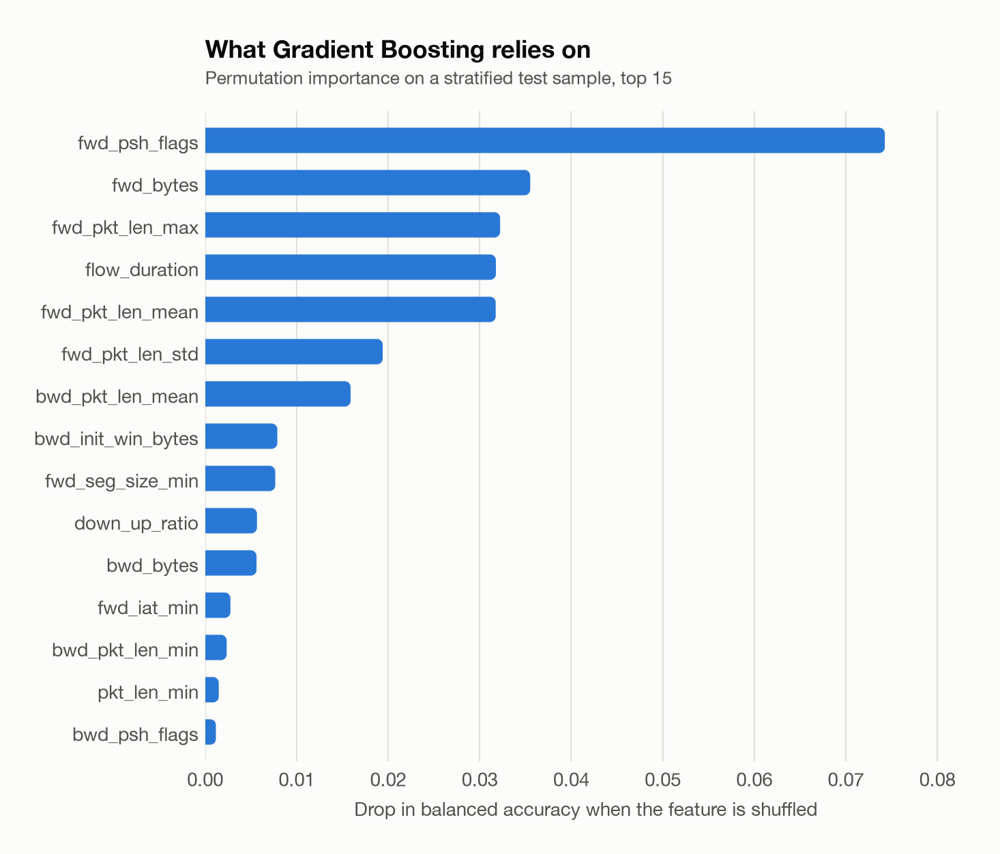

# FlowGuard evaluation report (cicids2017)

_Generated 2026-10-10T23:15:43+00:00 by `flowguard evaluate`. Every number below is recomputed from the saved models and test split._

## Data

| Step | Rows |
|---|---:|
| raw rows | 2,099,976 |
| attempted flows | 11,979 |
| dropped other protocols | 1,510 |
| wrapped header lengths | 593 |
| zero duration infinite rates | 5 |
| dropped non finite rows | 0 |
| dropped duplicates | 385,790 |
| clean rows | 1,712,676 |

| Family | Train | Train (after caps) | Validation | Test |
|---|---:|---:|---:|---:|
| BENIGN | 858,472 | 500,000 | 286,157 | 286,158 |
| DoS | 102,730 | 102,730 | 34,244 | 34,244 |
| DDoS | 57,086 | 57,086 | 19,029 | 19,029 |
| PortScan | 4,624 | 4,624 | 1,542 | 1,541 |
| BruteForce | 4,160 | 4,160 | 1,386 | 1,387 |
| WebAttack | 62 | 62 | 21 | 21 |
| Botnet | 442 | 442 | 147 | 147 |
| Infiltration | 22 | 22 | 7 | 7 |
| Heartbleed | 7 | 7 | 2 | 2 |

## Binary detection (test set)

Alert thresholds are calibrated on *validation* benign traffic for a false-positive budget: **0.10%** for supervised models (high-fidelity alerts) and **1.00%** for anomaly detectors (leads to triage). The test FPR shows how well each budget holds on unseen traffic.

| Model | Type | FPR budget | Detection rate | Test FPR | Precision | F1 | ROC-AUC | PR-AUC | Flows/s |
|---|---|---:|---:|---:|---:|---:|---:|---:|---:|
| Random Forest | supervised | 0.1% | 100.00% | 0.107% | 99.46% | 0.9973 | 1.0000 | 1.0000 | 328,503 |
| Gradient Boosting | supervised | 0.1% | 100.00% | 0.096% | 99.51% | 0.9976 | 1.0000 | 1.0000 | 190,320 |
| Isolation Forest | anomaly | 1.0% | 2.77% | 0.975% | 35.87% | 0.0514 | 0.8735 | 0.4018 | 80,812 |
| Autoencoder | anomaly | 1.0% | 10.83% | 1.039% | 67.25% | 0.1866 | 0.9081 | 0.5558 | 213,368 |
| Hybrid (GB + AE) | hybrid | – | 100.00% | 1.108% | 94.67% | 0.9726 | – | – | – |

### Detection rate at fixed false-positive budgets

Same models, thresholds re-calibrated on validation for each budget (the actual test FPR is in brackets).

| Model | FPR budget 0.1% | FPR budget 1.0% | FPR budget 5.0% |
|---|---:|---:|---:|
| Random Forest | 100.00% (0.11%) | 100.00% (0.76%) | 100.00% (2.22%) |
| Gradient Boosting | 100.00% (0.10%) | 100.00% (1.01%) | 100.00% (5.07%) |
| Isolation Forest | 0.06% (0.08%) | 2.77% (0.98%) | 8.34% (5.06%) |
| Autoencoder | 0.54% (0.11%) | 10.83% (1.04%) | 39.76% (5.10%) |

## Detection rate per family

| Family | Test flows | Random Forest | Gradient Boosting | Isolation Forest | Autoencoder | Hybrid (GB + AE) |
|---|---:|---:|---:|---:|---:|---:|
| DoS | 34,244 | 100.00% | 100.00% | 0.71% | 7.75% | 100.00% |
| DDoS | 19,029 | 100.00% | 100.00% | 0.00% | 11.73% | 100.00% |
| PortScan | 1,541 | 99.94% | 99.94% | 85.40% | 78.65% | 99.94% |
| BruteForce | 1,387 | 100.00% | 100.00% | 0.00% | 0.00% | 100.00% |
| WebAttack | 21 | 100.00% | 100.00% | 0.00% | 0.00% | 100.00% |
| Botnet | 147 | 100.00% | 100.00% | 0.00% | 2.04% | 100.00% |
| Infiltration | 7 | 100.00% | 100.00% | 14.29% | 71.43% | 100.00% |
| Heartbleed | 2 | 100.00% | 100.00% | 100.00% | 100.00% | 100.00% |
| BENIGN (false-positive rate) | 286,158 | 0.11% | 0.10% | 0.98% | 1.04% | 1.11% |

## Attack-family classification (Gradient Boosting)

Operational predictions (alert threshold applied): macro-F1 **0.7962**, weighted-F1 **0.9992** (plain argmax: macro-F1 0.9154).

| Family | Precision | Recall | F1 | Support |
|---|---:|---:|---:|---:|
| BENIGN | 1.0000 | 0.9990 | 0.9995 | 286,158 |
| Botnet | 0.9608 | 1.0000 | 0.9800 | 147 |
| BruteForce | 0.9943 | 1.0000 | 0.9971 | 1,387 |
| DDoS | 1.0000 | 1.0000 | 1.0000 | 19,029 |
| DoS | 0.9983 | 1.0000 | 0.9992 | 34,244 |
| Heartbleed | 0.1667 | 0.5000 | 0.2500 | 2 |
| Infiltration | 0.1750 | 1.0000 | 0.2979 | 7 |
| PortScan | 0.9123 | 0.9994 | 0.9539 | 1,541 |
| WebAttack | 0.5250 | 1.0000 | 0.6885 | 21 |

## Zero-day simulation (leave one family out)

Each attack family is removed from training in turn; a supervised model is re-fitted and re-calibrated, then scored on the held-out family. The autoencoder never sees attacks, so its numbers are the same with or without the family.

| Held-out family | Test flows | Supervised (seen) | Supervised (unseen) | Autoencoder | Hybrid (unseen) |
|---|---:|---:|---:|---:|---:|
| DoS | 34,244 | 100.0% | 33.3% | 7.7% | 36.9% |
| DDoS | 19,029 | 100.0% | 100.0% | 11.7% | 100.0% |
| PortScan | 1,541 | 99.9% | 2.5% | 78.7% | 80.4% |
| BruteForce | 1,387 | 100.0% | 4.8% | 0.0% | 4.8% |
| Botnet | 147 | 100.0% | 0.0% | 2.0% | 2.0% |
| WebAttack | 21 | 100.0% | 0.0% | 0.0% | 0.0% |
| **Mean** | | **100.0%** | **23.4%** | **16.7%** | **37.4%** |

## Robustness probe: one HTTP flood, seven implementations

300 connections of a Hulk-style flood from a single source, generated as packets and metered by FlowGuard. The baseline replicates the dominant DoS Hulk flow of CICIDS2017; every other row changes one implementation detail that has nothing to do with the traffic being a flood.

| Variant | Gradient Boosting | Autoencoder | Hybrid |
|---|---:|---:|---:|
| CICIDS2017 Hulk replica | 100.0% | 0.0% | 100.0% |
| Different victim TCP window | 100.0% | 0.0% | 100.0% |
| Different victim page size (5 kB) | 100.0% | 0.0% | 100.0% |
| Fast server (1 ms) | 100.0% | 0.0% | 100.0% |
| Graceful close (FIN) | 100.0% | 0.0% | 100.0% |
| MSS-sized segments | 86.3% | 0.0% | 86.3% |
| Graceful close + MSS segments | 0.0% | 0.0% | 0.0% |

## Most important features

| Feature | Balanced-accuracy drop |
|---|---:|
| `fwd_psh_flags` | 0.0743 |
| `fwd_bytes` | 0.0355 |
| `fwd_pkt_len_max` | 0.0322 |
| `flow_duration` | 0.0318 |
| `fwd_pkt_len_mean` | 0.0317 |
| `fwd_pkt_len_std` | 0.0194 |
| `bwd_pkt_len_mean` | 0.0159 |
| `bwd_init_win_bytes` | 0.0079 |
| `fwd_seg_size_min` | 0.0077 |
| `down_up_ratio` | 0.0057 |

## Training cost

| Model | Fit time (s) |
|---|---:|
| Random Forest | 70.0 |
| Gradient Boosting | 31.1 |
| Isolation Forest | 2.0 |
| Autoencoder | 50.4 |
